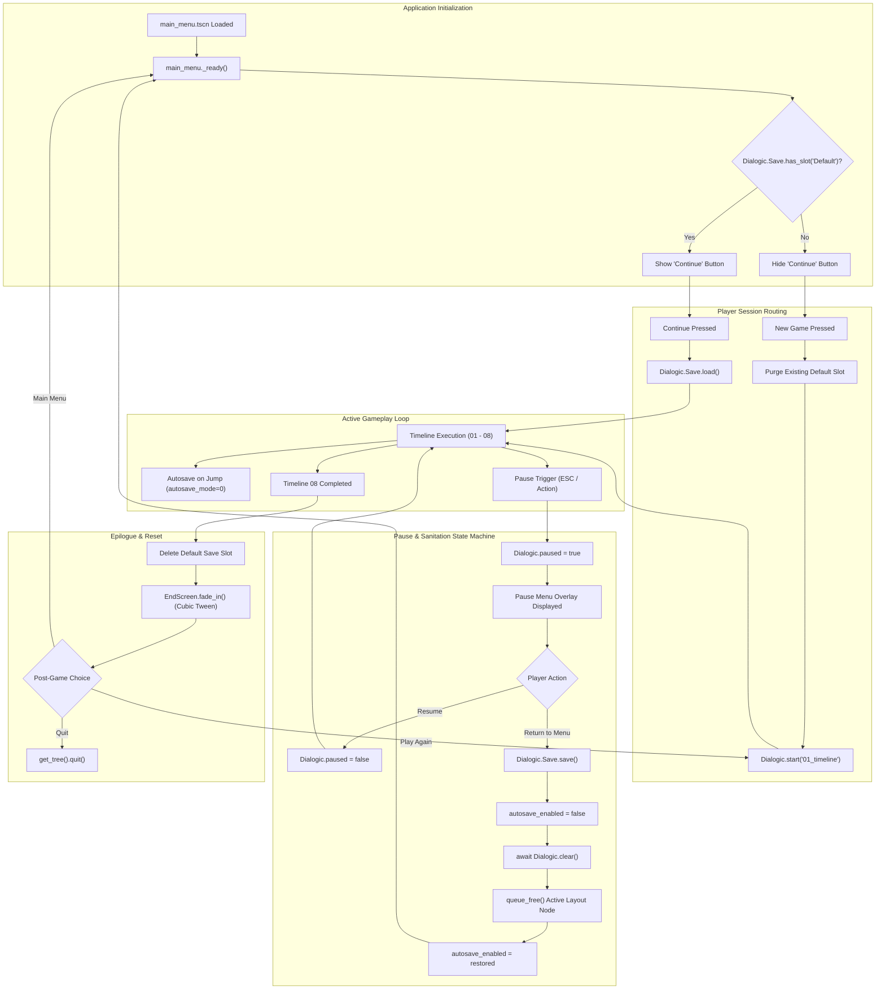

# Timelapse

<div align="center">

[](https://godotengine.org)
[](https://docs.godotengine.org/en/stable/tutorials/scripting/gdscript/)
[](https://github.com/dialogic-godot/dialogic)
[]()
[]()
[](LICENSE)

<p align="center">
  <strong>A narrative-driven visual novel engineered in Godot 4.7 Forward+ and Dialogic 2.</strong><br>
  Demonstrating robust session lifecycle management, decoupled signal architectures, and deterministic state persistence.
</p>

</div>

---

## Overview

**Timelapse** is an episodic visual novel chronicling a cosmically disproportionate time-travel prank orchestrated by ancient deities—Osiris, Voxar, and Horus—against Lucifer in a heavenly kitchen over an empty carton of milk.

Beyond its comedic narrative, this project is designed as an architectural showcase for **Godot 4.7** and **Dialogic 2**, implementing production-grade patterns for:
- Deterministic game-save persistence and autosave orchestration.
- Safe teardown and memory cleanup of runtime dialogue canvas trees.
- Signal-driven, decoupled UI state machines (Title Screen, Pause Overlay, and Epilogue).
- Custom synthwave theme skinning and responsive layout management.

---

## Technology Stack

| Component | Technology | Description |
|---|---|---|
| **Game Engine** | Godot Engine 4.7.1 Forward+ | CanvasItems stretch mode, high-res DPI scaling, and Jolt 3D physics integration. |
| **Narrative Engine** | Dialogic 2 (Alpha) | Resource-driven `.dtl` timelines, character definitions (`.dch`), and text styling. |
| **Scripting** | GDScript 2.0 | Strictly typed scripts with custom signals and asynchronous lifecycle awaits. |
| **Audio Pipeline** | Godot Audio Bus | Dynamic timeline music streaming (`.ogg`) and theme-matched looping tracks. |
| **Export Target** | macOS Universal (`arm64` + `x86_64`) | Optimized universal distribution presets configured in `export_presets.cfg`. |

---

## Architectural Deep Dive

### Save/Load & Session Lifecycle State Machine

The core technical hurdle in dialogue-driven games is avoiding dangling UI nodes, race conditions during save triggers, and orphaned audio streams when transitioning between menus and active narrative scenes. 

Timelapse resolves this using an explicit **Lifecycle & Sanitation State Machine**:



---

### Key Engineering Patterns

#### 1. Race-Condition-Free Scene Teardown & Layout Sanitation

When the player returns to the main menu from an active timeline, unbinding Dialogic's dynamic layout node without triggering spurious autosaves or memory leaks requires temporary subsystem suppression:

```gdscript
# File: main_menu.gd
func _on_pause_menu_main_menu() -> void:
    Dialogic.paused = false
    Dialogic.Save.save() # Persist current state before unloading
    _last_timeline = ""

    # Suppress autosave during asynchronous cleanup to prevent overwriting
    # valid save state with an empty/partial node state
    var autosave_was_enabled: bool = Dialogic.Save.autosave_enabled
    Dialogic.Save.autosave_enabled = false

    await Dialogic.clear()
    
    # Prune residual layout canvas items from the scene tree
    if Dialogic.Styles.has_active_layout_node() and Dialogic.Styles.get_layout_node().is_inside_tree():
        var layout_node := Dialogic.Styles.get_layout_node()
        layout_node.get_parent().remove_child(layout_node)
        layout_node.queue_free()

    # Restore autosave configuration
    Dialogic.Save.autosave_enabled = autosave_was_enabled
    _show_main_menu()
```

#### 2. Signal-Driven Modular UI Decoupling

The root `main_menu.gd` acts as a coordinator, never coupling directly to internal implementations of child overlays. The in-game `PauseMenu` (`CanvasLayer`) and `EndScreen` (`Control`) interact purely through typed Godot signals:

```gdscript
# File: pause_menu.gd
extends CanvasLayer

signal resume_pressed
signal main_menu_pressed

func _unhandled_input(event: InputEvent) -> void:
    if not visible:
        return

    # Trap escape/pause inputs without polluting global input propagation
    if event.is_action_pressed("pause") or (event is InputEventKey and event.pressed and not event.is_echo() and event.keycode == KEY_ESCAPE):
        get_viewport().set_input_as_handled()
        close()
        resume_pressed.emit()
```

#### 3. Automatic vs. Manual State Serialization

Dialogic's subsystem is configured via `project.godot` to autosave on timeline jumps:
- `save/autosave = true`
- `save/autosave_mode = 0` (Triggers on `timeline_started`, `timeline_ended`, and internal `[jump]` events).
- `[save]` event hooks at the entry point of each chapter guarantee deterministic reload anchors even during unexpected process termination.

---

## Project Structure

```
timelapse/
├── project.godot               # Engine configuration (Dialogic autoloads, input maps, renderer settings)
├── export_presets.cfg          # macOS Universal export profile definitions
│
├── main_menu.tscn / .gd        # Main scene orchestrator (manages lifecycle, audio, and view transitions)
├── pause_menu.tscn / .gd       # Isolated pause overlay (CanvasLayer, input trapping, state toggles)
├── end_screen.tscn / .gd       # Animated epilogue screen (Tween-driven opacity fade & replay triggers)
│
├── timelines/                  # Narrative timeline scripts (.dtl)
│   ├── 01_timeline.dtl         # Chapter 1: The One-Trillion-Year Scheme
│   ├── ...                     # Sequential narrative chapters
│   └── 08_timeline.dtl         # Finale: The Grand Reckoning & Epilogue hook
│
├── characters/                 # Character resource definitions (.dch)
│   ├── horus.dch               # Horus: Portrait anchors, color coding, expressions
│   ├── osiris.dch              # Osiris: Divine comic relief
│   ├── vox.dch                 # Voxar: Vengeful instigator
│   └── ...                     # Additional pantheon members (Zeus, Lucifer, Aphrodite, etc.)
│
├── speech_styles/              # Dialogic UI layouts & text boxes
│   └── default.tres            # Custom dialogue layout resource
│
├── synthwave_theme.tres        # Custom button styling, font styling, hover states, and cursors
├── backgrounds/                # High-resolution environments (Council rooms, castles, kitchen)
├── images/                     # Dynamic 2D character expression portraits
└── music/                      # Timeline-synchronized looping audio tracks (.ogg)
```

---

## Developer Quick Start

### Prerequisites
- [Godot Engine 4.7+](https://godotengine.org/download) with Forward+ rendering support.

### Running Locally

1. **Clone the repository:**
   ```bash
   git clone https://github.com/leouofa/timelapse.git
   cd timelapse
   ```

2. **Launch via Godot Editor:**
   - Open the Godot project manager.
   - Click **Import**, navigate to this folder, and select `project.godot`.
   - Press <kbd>F5</kbd> (or click **Play**) to launch `main_menu.tscn`.

3. **Launch via Command Line (macOS):**
   ```bash
   /Applications/Godot.app/Contents/MacOS/Godot --path .
   ```

### Controls

| Action | Input Mapping |
|---|---|
| **Advance Dialogue** | <kbd>Left Click</kbd> / <kbd>Space</kbd> / <kbd>Enter</kbd> / <kbd>X</kbd> |
| **Pause / Resume** | <kbd>Escape</kbd> |
| **Menu Navigation** | Mouse or Keyboard focus |

---

## Credits & Attributions

- **Author**: Created by [@leouofa](https://github.com/leouofa)
- **Engine**: [Godot Engine](https://godotengine.org) (MIT License)
- **Dialogue System**: [Dialogic 2](https://github.com/dialogic-godot/dialogic) by Emilio Coppola and contributors (MIT License)
- **Soundtrack**: *"Three Red Hearts"* by [Abstraction](https://abstractionmusic.com)
- **License**: Released under the [MIT License](LICENSE).
